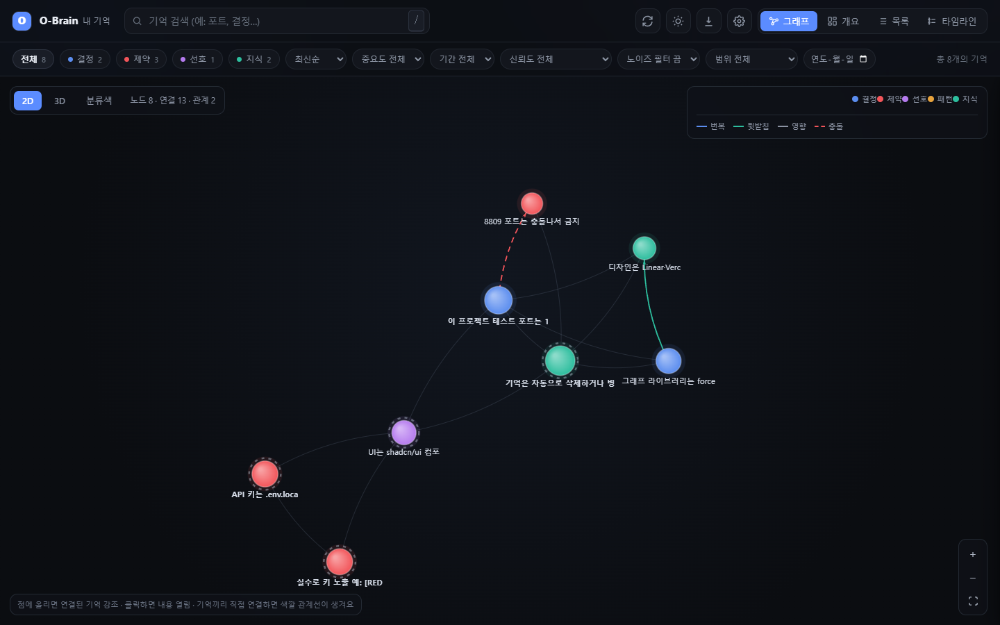
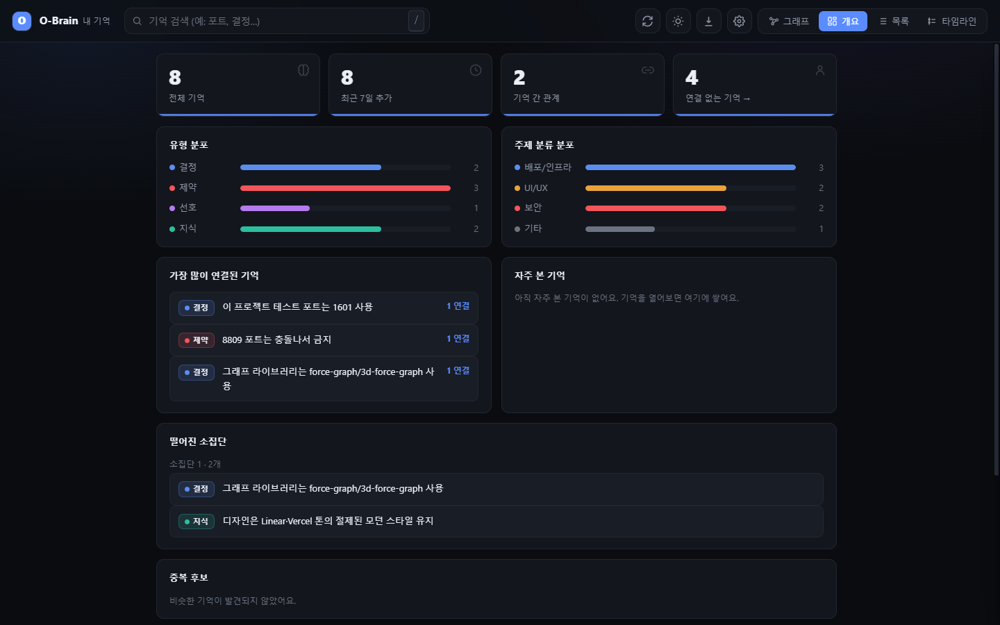
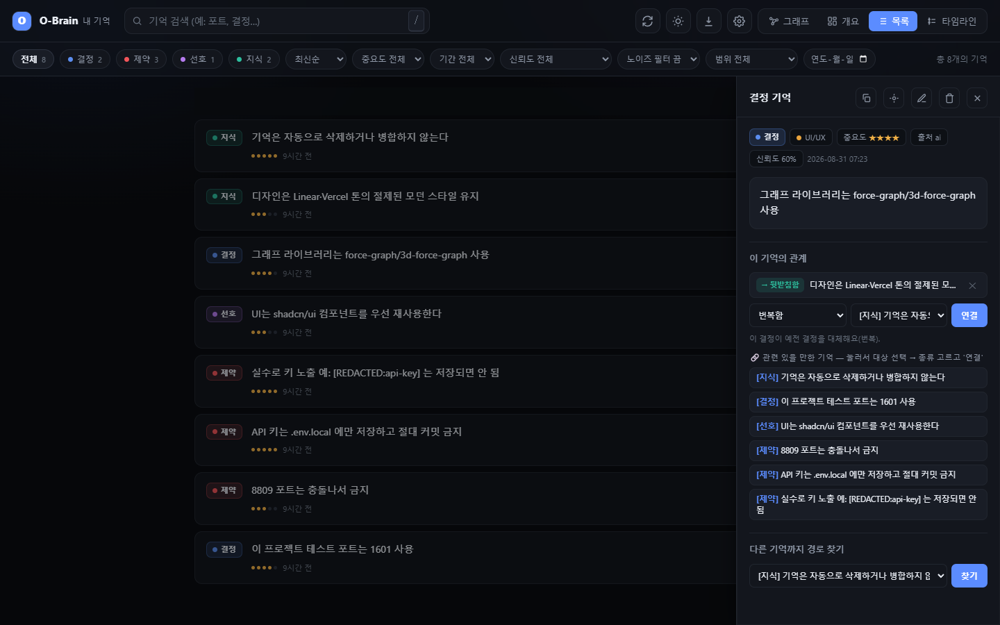
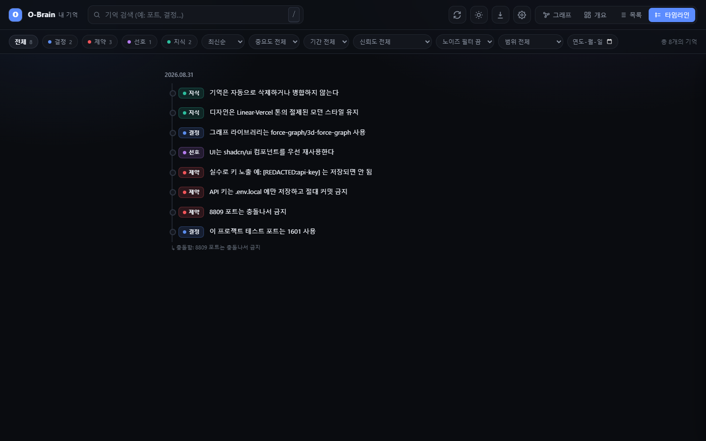
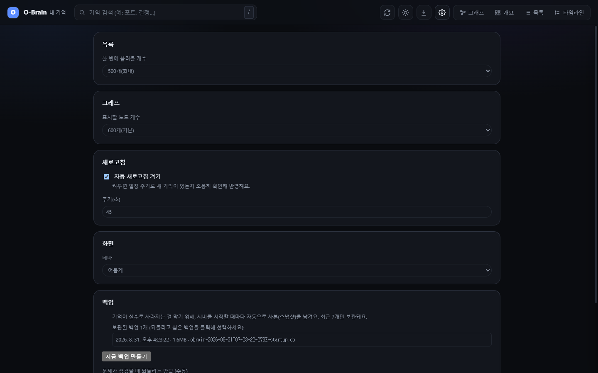

<!-- 한국어: 이 파일 · English: README.en.md · (이 문서와 README.html 내용 동일) -->

# 소담 오브레인 (SoDam O-Brain) — AI 기억 시스템

> **AI와 나눈 대화에서 중요한 결정·약속을 자동으로 저장하고, 지식 그래프로 시각화하는 완전 로컬 기억 도구.**

**비유 한 줄:** AI는 천재지만 대화가 끝나면 모든 걸 잊어버립니다.
O-Brain은 그 AI 옆에 두는 **자동 메모 노트**예요. 중요한 말을 알아서 적어두고, 언제든 꺼내줍니다.

---

## 목차

1. [핵심 기능](#핵심-기능)
2. [사전 준비물](#사전-준비물)
3. [다운로드 방법](#다운로드-방법)
4. [설치 (2단계)](#설치-2단계) · [업데이트하기](#업데이트하기)
5. [Claude Code 플러그인 방식 (선택)](#claude-code-플러그인-방식-선택)
6. [MCP 도구 연동 (Claude Code)](#mcp-도구-연동-claude-code)
7. [빠른 시작](#빠른-시작)
8. [실행 · 사용 방법](#실행--사용-방법)
9. [주요 명령어](#주요-명령어)
10. [파일·데이터 위치](#파일데이터-위치)
11. [워크플로우](#워크플로우)
12. [아키텍처 요약](#아키텍처-요약)
13. [보안 개요 · 데이터 흐름](#보안-개요--데이터-흐름)
14. [업데이트 내용 요약](#업데이트-내용-요약)
15. [문제해결 빠른 참조](#문제해결-빠른-참조)
16. [FAQ](#faq-자주-묻는-질문)
17. [라이선스 · 저작권 · 상업적 용도](#라이선스--저작권--상업적-용도)

---

## 핵심 기능

| 기능 | 설명 |
|------|------|
| **100% 로컬** | 모든 기억이 내 PC에만 저장됩니다. 외부 서버·클라우드 전송 없음 |
| **하이브리드 검색** | 키워드(FTS5) + 의미 유사도(벡터 검색)를 동시에 사용 |
| **지식 그래프** | 기억들을 2D/3D 점과 선으로 시각화 |
| **최단경로 찾기** | 상세 패널에서 다른 기억을 골라 "경로 찾기"를 누르면 두 기억이 관계로 몇 단계를 거쳐 이어지는지 찾아 그래프에서 그 경로를 강조 표시(탭 전환·2D/3D 전환 후에도 강조 유지). 연결이 없으면 "연결된 경로가 없어요"로 안내 |
| **시간여행** | 날짜 지정으로 그 날 기준 살아있던 기억만 조회 |
| **신뢰도 감쇠** | AI 추출 기억은 30일 반감기로 신뢰도 자동 감소 |
| **보안 필터** | API 키·비밀번호 자동 제거 후 저장 (`[REDACTED]`) |
| **자동 백업 + 백업 카드** | 서버를 켤 때·삭제/병합/가져오기 직전에 자동 백업(종류별로 따로 보관). 헤더 ⬇ **데이터** 화면의 백업 카드에서 목록(종류·날짜·기억 건수·"열어서 확인함")·"지금 백업 만들기"(.db)·"이식용 백업"(.json.gz, 다른 PC로 옮기기)·내려받기, 되돌리기는 `npm run restore` |
| **MCP 연동** | Claude Code에서 7개 도구로 기억 저장·검색·관계 관리 |
| **고아 노드 시각화** | 관계 없는 기억에 점선 테두리 표시 |
| **일괄 선택·삭제** | 여러 기억을 한 번에 선택해 삭제 + 10초 안에 되돌리기 |
| **⚙ 설정 페이지** | 목록 개수·그래프 노드 개수·자동 새로고침·테마·안내 배너를 화면에서 직접 조절, 브라우저에 저장돼 계속 유지 |
| **중복 기억 정리** | 비슷한 기억 쌍을 자동으로 찾아 보여주고, 확인 후 병합·삭제(백업+10초 되돌리기) |
| **완전일치 중복 일괄 정리** | 내용이 완전히 똑같은 기억 쌍이 여러 건이면 "완전일치만 전부 한번에 정리" 버튼 하나로 모두 삭제(기존 건별 확인 방식과 별개, 백업+10초 되돌리기 동일 적용) |
| **API 토큰 검증** | 모든 API 요청에 로컬 토큰 검사, 없거나 틀리면 차단 |
| **성능 가드** | 기억이 많아지면(1500건+) 그래프 연산을 자동으로 단순화해 멈춤 방지 |
| **믿을 수 있는 검색 순위** | 사람이 확인한 기억이 자동추출 노이즈보다 검색 결과 위쪽에 오도록 관련도·중요도·최신성·신뢰도를 함께 반영 |
| **저신뢰 기억 필터** | 목록 탭에서 자동 추출 신뢰도가 낮은(50% 미만) 기억만 골라 검토 가능 |
| **그래프 안정성·키보드 접근성** | 그래프를 못 불러오면 오류 안내+다시 시도 버튼 표시, 마우스 없이 Tab·Enter만으로 그래프의 모든 기억을 탐색·조회 가능 |
| **노이즈 기억 필터** | 목록 탭에서 대화 요약·인용문이 실수로 기억으로 잘못 저장된 것을 골라 확인·일괄 정리(전체 선택 버튼) |
| **관계 제안 큐** | 개요 탭에서 연결 없는 기억을 하나씩 보여주고, 비슷한 기억과 연결할지 사람이 직접 결정(자동 연결 아님) |
| **내보내기 6종** | 헤더 ⬇ **데이터** 화면에서 기억을 JSON·JSON Lines·CSV(엑셀)·마크다운·텍스트·HTML(인쇄→PDF) 파일로 — 전체/지금 목록/고른 것/프로젝트 하나, 폴더 경로 빼기(기본), 압축(.gz), 내려받기 또는 이 PC 폴더에 저장 |
| **가져오기** | 위 형식 파일(JSON·JSONL·CSV·TSV·마크다운·TXT, .gz 포함)을 끌어다 놓기 → **미리보기**(새것·중복·시크릿 가림·오류) → 확인 → 자동 백업 → 진행 바 → 30분 안 되돌리기. 외부 파일은 "검토 필요"로 들어와 새 대화에 자동으로 불러오지 않음 |

---

## 사전 준비물

| 항목 | 요구 사항 |
|------|-----------|
| 운영체제 | Windows 10 / 11 (64-bit) |
| Node.js | **26.7.x** ([nodejs.org](https://nodejs.org)에서 설치). 이 프로젝트는 `app/package.json`의 `engines`(`~26.7.0`)와 `app/.nvmrc`로 **26.7 계열에 맞춰져** 있어요. Node가 다른 버전이면 기억 저장이 조용히 실패할 수 있습니다 |
| 저장 공간 | 500 MB 이상 (임베딩 모델 ~90 MB 포함) |
| RAM | 4 GB 이상 (8 GB 이상 권장) |
| 브라우저 | Chrome, Edge, Firefox 등 |

> Claude Code는 MCP 도구 연동·플러그인 설치 시에만 필요. 웹 대시보드는 Claude Code 없이도 사용 가능.

---

## 다운로드 방법

이 문서를 읽고 있다면 O-Brain 파일은 이미 내 컴퓨터에 있습니다. 프로젝트 폴더 위치만 확인하면 됩니다(현재 이 PC 기준 절대경로).

Git으로 받는 경우(개발자용):

```bash
git clone https://github.com/sodam-ai/SoDam_O-Brain.git
cd SoDam_O-Brain
```

> 이 저장소는 공개(public)라 별도 권한 없이 받을 수 있습니다. (비공개로 바뀌면 접근 권한이 필요해요.)

---

## 설치 (2단계)

**1단계: 의존성 설치 (터미널에서)**

```bash
cd <저장소를 내려받은 폴더>\app
npm install
```

> 예시: 저장소를 `C:\Tools\O-Brain`에 내려받았다면 `cd C:\Tools\O-Brain\app`

**2단계: 서버 시작**

```bash
npm start
```

→ `O-Brain 로컬 서버 ▶ http://127.0.0.1:7740` 메시지가 나오면 성공.

**브라우저에서 열기:**

```
http://127.0.0.1:7740
```

> **첫 실행 시**: AI 임베딩 모델(약 90 MB)을 자동 다운로드합니다. 1~3분 소요. 이후 실행부터는 즉시 시작.

### 업데이트하기

새 버전을 받은 뒤에는 아래 순서로 해 주세요. Windows는 실행 중인 파일을 바꿀 수 없어서 **먼저 모두 끄는 것**이 중요해요.

1. O-Brain 서버를 켜 둔 터미널에서 `Ctrl+C`로 끄고, **클로드코드 창도 모두 닫아요**.
2. 새 버전을 받아요 — git으로 받았다면 `git pull`, 압축 파일이면 새로 받은 내용으로 덮어써요. (`app/data/` 안의 내 기억은 건드리지 않아요.)
3. 터미널에서 `app` 폴더로 가서 `npm ci`를 실행해요 — 저장소의 `package-lock.json`에 적힌 **검증된 버전 그대로** 설치해요(`npm install`보다 안전해요). 몇 분 걸릴 수 있어요.
4. `npm run selftest`로 점검해요(✅가 쭉 나오고 마지막에 🎉가 나오면 정상). 이어서 `npm start`로 서버를 켜요.
5. 클로드코드 플러그인을 쓰고 있다면 `npm run plugin:pin`을 한 번 실행한 뒤, 새 클로드코드 창에서 `/plugin`으로 업데이트해요.
6. 브라우저에 **이전에 열어 둔 O-Brain 화면**이 있다면 "서버가 다시 시작된 것 같아요" 안내가 뜰 수 있어요. 그때는 **화면 새로고침** 버튼(또는 `F5`)을 누르면 돼요.

> 서버를 켤 때마다 기억 데이터베이스는 자동으로 백업되고 구조도 자동으로 맞춰져요. 무언가 이상하면 아래 "문제해결 빠른 참조"의 `npm run restore`로 되돌릴 수 있어요.

---

## Claude Code 플러그인 방식 (선택)

Claude Code를 사용 중이라면 플러그인으로도 설치 가능합니다. **반드시 2단계로 나눠서** 실행하세요(한 번에 설치 시도 시 "Marketplace not found" 오류):

```
/plugin marketplace add <저장소를 내려받은 폴더>\plugin
/plugin install o-brain@o-brain-local
```

> 예시: `/plugin marketplace add C:\Tools\O-Brain\plugin`

> ⚠️ **설치(또는 업데이트) 전에 한 번만**: `/plugin`으로 설치하면 플러그인 파일이 Claude Code의 캐시 폴더로 **복사**돼서 옆에 `app` 폴더가 없어집니다. 그래서 설치·업데이트 **전에** 터미널에서 `app` 폴더로 가서 `npm run plugin:pin`을 한 번 실행해 O-Brain 위치를 등록해 주세요(내 사용자 폴더의 `.obrain/root` 파일에 위치 한 줄이 저장됩니다). 등록하지 않으면 대화를 시작할 때 "app 폴더를 찾지 못했어요" 안내가 나오며, 그때 같은 명령을 실행하면 됩니다.

설치 후 Claude Code 재시작 → 슬래시 명령어 사용 가능:

| 명령 | 하는 일 |
|------|---------|
| `/o-brain:status` | 현재 기억 수·상태 조회 |
| `/o-brain:selftest` | 저장·검색·보안 일괄 점검 (✅✅✅이면 정상) |
| `/o-brain:remember` | 현재 대화에서 결정 추출·저장 |
| `/o-brain:link` | 기억끼리 관계 연결 |
| `/o-brain:backup` | 수동 백업 생성 |
| `/o-brain:open` | 브라우저로 대시보드 열기(서버가 꺼져 있으면 자동으로 켬) |

---

## MCP 도구 연동 (Claude Code)

Claude Code `settings.json`에 등록하면 대화 중 기억을 바로 저장·검색할 수 있습니다:

```json
{
  "mcpServers": {
    "o-brain": {
      "command": "node",
      "args": ["C:/절대경로/app/src/mcp-server.mjs"]
    }
  }
}
```

> 경로는 **절대 경로**, 슬래시(`/`) 사용 — 백슬래시(`\`) 쓰면 오작동할 수 있습니다.

사용 가능한 MCP 도구: `save_memory`, `search_memory`, `get_memory`, `get_related`, `get_timeline`, `add_relation`, `list_categories`

---

## 빠른 시작

1. `npm install` (최초 1회) → `npm start`
2. 브라우저에서 `http://127.0.0.1:7740` 열기
3. (Claude Code 사용자) 평소처럼 대화 중 또렷한 결정 문장을 말하고 `/clear` → 자동 저장
4. 화면 우측 상단 **⚙ 설정**에서 목록 개수·그래프 노드 개수 등을 취향대로 조절

---

## 실행 · 사용 방법

### 실행

```bash
# app 폴더에서 실행
npm start                              # 서버 시작 (기본 포트 7740)
$env:OBRAIN_PORT=7741; npm start       # 포트를 바꿔서 시작 (PowerShell)
```

서버 종료: 터미널에서 `Ctrl + C`.

### 사용 — 웹 대시보드 (5개 탭)

| 탭 | 설명 |
|----|------|
| **그래프** | 기억을 점과 선으로 표시하는 지식 맵. 첫 화면. |
| **개요** | 총 기억 수, 유형별·카테고리별 분포, 연결 많은 기억 |
| **목록** | 기억을 카드 형태로 나열. 선택 모드로 일괄 삭제 가능 |
| **타임라인** | 시간순으로 기억 표시 |
| **⚙ 설정** | 목록/타임라인/개요 불러오기 개수, 그래프 표시 노드 개수, 자동 새로고침 켜짐·주기, 테마, 안내 배너 표시 여부 — 5개 항목을 이 화면에서 직접 조절. 값은 브라우저(localStorage)에 저장돼 다음에 열어도 유지됨 |

#### 화면 미리보기

> 아래는 예제(합성 더미) 데이터로 채운 실제 화면입니다 — 실제 개인 기억이 아닙니다.

**그래프 뷰 — 2D/3D 지식그래프** (빨강 점선=모순됨, 초록 실선=뒷받침)


**개요 탭 — 통계·분포**


**목록 탭 — 카드 목록 + 상세 패널**


**타임라인 탭 — 시간순 기억**


**설정 탭 — 5개 조절 항목**


### 데이터 화면 — 내보내기 · 가져오기 · 백업

헤더 오른쪽의 **⬇ 버튼**(또는 `Ctrl+K` → "데이터 관리")으로 엽니다. 위에서부터 **내보내기 · 가져오기 · 백업** 세 칸이에요.

**① 내보내기** — 기억을 파일로 꺼내요(원본은 그대로 남아요).

| 쓰임새 | 고를 형식 |
|--------|-----------|
| 엑셀·구글 시트에서 보기 | **CSV** (한글이 안 깨져요, 관계는 빠져요) |
| 다른 PC로 옮기기·통째로 보관 | **JSON** (관계 포함, 다시 가져올 수 있어요) |
| 옵시디언·노션 같은 메모 앱 | **마크다운(.md)** |
| 읽기·인쇄·PDF | **HTML** (열어서 `Ctrl+P` → "PDF로 저장") |
| 개발자·데이터 분석 | **JSON Lines** (한 줄에 기억 하나) |
| 메모장·메신저에 붙여넣기 | **텍스트(.txt)** |

범위는 *전체 / 지금 목록에 불러온 것 / 목록에서 고른 것 / 프로젝트 하나만* 중에서 고릅니다. **"폴더 경로 빼기"는 기본으로 켜져 있어요**(남에게 보여줄 때 안전합니다. 내 다른 PC로 옮길 때는 끄세요). "내려받기"는 브라우저 다운로드 폴더로, "이 PC 폴더에 저장"은 `app/data/export/`에 저장하고 위치를 알려 줍니다. 압축(.gz) 옵션도 있어요.

**② 가져오기** — 파일에서 기억을 들여와요.

1. 파일을 끌어다 놓거나 "파일 고르기" — `JSON`·`JSON Lines`·`CSV`·`TSV`·`마크다운`·`텍스트`, 그리고 이걸 `.gz`로 압축한 것(최대 5MB · 5,000건). 엑셀 `.xlsx`는 "다른 이름으로 저장 → CSV UTF-8"로 바꿔 올려 주세요. 한글 윈도우 CSV(CP949)도 읽어요.
2. **미리보기** — 새로 들어올 기억, 이미 있어서 건너뛸 것, 읽지 못한 줄, 시크릿이 가려진 기억을 먼저 보여 줘요. 이 단계에서는 아무것도 저장되지 않아요.
3. "가져오기"를 누르면 먼저 지금 기억을 **자동 백업**하고 저장해요(진행 바 표시. 중간에 멈추면 아무것도 저장되지 않아요).
4. 끝난 뒤 **30분 안에는 "되돌리기"**로 방금 가져온 것만 지울 수 있어요.

> ⚠️ 외부에서 받은 파일은 기억 속 문장이 AI에게 지시처럼 섞일 수 있어서, 기본으로 **"검토 필요"(신뢰도 40%)**로 들어오고 **새 대화에 자동으로 불러오지 않아요**. 기억을 열어 내용을 확인하고 저장하면 정식 기억이 됩니다. 내가 직접 만든 파일(이 화면에서 내보낸 JSON 등)이면 "믿을 수 있는 파일" 체크를 켜세요 — 파일에 적힌 출처·신뢰도를 그대로 씁니다. 비밀번호·API 키로 보이는 부분은 가져올 때도 자동으로 가려져요.

**③ 백업** — 사고에 대비한 사본이에요.

- **자동**: 서버를 켤 때, 그리고 기억을 지우기·합치기·가져오기 직전에 만들어져요. 종류별로 따로 보관해요(서버 시작 7개 · 위험 작업 직전 7개).
- **직접**: "지금 백업 만들기"(`.db`, 10개까지)와 "이식용 백업"(`.json.gz`, 10개까지 — 다른 PC로 옮길 때 새 PC의 "가져오기"에 올려요). 직접 만든 백업은 자동 백업에 밀려나지 않아요.
- 목록에는 종류·날짜·용량·기억 건수·"열어서 확인함 ✔"이 보이고, **내려받기**로 파일을 따로(USB·클라우드) 보관할 수 있어요.
- **되돌리기**는 화면이 아니라 터미널에서 해요(열려 있는 데이터 파일을 덮어쓰면 망가질 수 있어서입니다). 서버·클로드코드 창을 모두 닫고 `app` 폴더에서 `npm run restore` → 번호 선택 → `yes`. 지금 데이터는 먼저 자동 백업되고, 원래 파일은 지워지지 않고 옆에 남아요.

---

## 주요 명령어

```bash
# app/ 폴더에서 실행
npm start          # 서버 시작 (포트 7740)
npm run selftest   # 자가 진단
npm run backup     # 수동 백업(.db)
npm run backup -- --portable   # 이식용 백업(.json.gz, 다른 PC로 옮길 때)
npm run restore    # 백업으로 되돌리기(서버·클로드코드 창을 모두 닫고 실행)
npm run status     # DB 상태 조회(마지막 자동 저장 성공 여부·의미검색 상태 포함)
npm run reindex    # 의미검색용 정보가 빠진 기억 채우기(의미검색이 멈췄던 뒤에)
npm run plugin:pin # /plugin 설치용 위치 등록(플러그인 설치·업데이트 전 1회)
npm run seed       # 예제 데이터 입력 (테스트용)
```

---

## 파일·데이터 위치

| 항목 | 위치 |
|------|------|
| 기억 데이터베이스 | `app/data/obrain.db` |
| 백업 | `app/data/backup/` (종류별 보관: 서버 시작 7 · 위험 작업 직전 7 · 직접 만든 .db 10 · 이식용 .json.gz 10) |
| 내보낸 파일 | `app/data/export/` ("이 PC 폴더에 저장"을 고른 경우) |
| API 토큰 파일 | `app/data/.api-token` (실행마다 갱신) |
| 개인 설정 | `app/.env.local` (없으면 기본값 사용) |
| 이 문서 | 프로젝트 최상위(`README.md`/`README.en.md`/각 `.html`) |
| `app/web/graph.html` | **의도적으로 남겨둔 초기 시제품 파일**(지금 쓰는 화면은 `index.html`). 코드 어디서도 안 쓰이는 죽은 파일이지만, 개발 초기 기록 보존 목적으로 삭제하지 않고 그대로 둠 |

> ⚠️ **멈추고 확인**: `app/data` 폴더(기억 DB)를 **삭제·이동·덮어쓰기** 하기 전에는 먼저 `npm run backup`으로 백업하세요. 지운 기억은 되돌릴 수 없습니다. OneDrive 같은 클라우드 동기화 폴더 안에서는 DB가 깨질 수 있으니 쓰지 마세요.

### 환경 변수 (`app/.env.local`)

| 변수 | 기본값 | 설명 |
|------|--------|------|
| `OBRAIN_PORT` | `7740` | 서버 포트 번호 |
| `OBRAIN_DATA_DIR` | `./data` | 데이터 저장 폴더 |
| `OBRAIN_CAPTURE_SDK` | (꺼짐) | `1`로 설정하면 프로그램이 호출한 세션(`claude -p`·Agent SDK 등)의 대화도 자동 저장합니다. 기본은 **사람이 직접 쓴 글만** 저장 |
| `OBRAIN_EMBED_DISABLE` | (꺼짐) | `1`로 설정하면 의미검색(임베딩 모델)을 끄고 키워드 검색만 씁니다(진단·저사양용). 끄면 새 기억에 검색용 정보가 생기지 않으니, 다시 켠 뒤 `npm run reindex`로 채우세요 |

---

## 워크플로우

**일반 사용자(웹 UI 중심):** 아침에 `npm start` → 어제 기억 확인 → 작업 중 중요 결정 직접 입력 → 저녁에 관계 연결·정리.

**Claude Code 사용자(MCP/플러그인):** 대화 중 결정을 말하고 `/clear`로 세션 종료 → 자동 저장 → 가끔 `/o-brain:open`으로 화면 확인 → `/o-brain:backup`으로 주기적 백업.

---

## 아키텍처 요약

```
[Claude Code / 브라우저]
        ↓
[Express 서버 127.0.0.1:7740]
        ↓
[보안 필터] → [임베딩(로컬 AI)] → [SQLite DB]
                                    ├── FTS5 (키워드 검색)
                                    └── sqlite-vec (벡터 검색)
```

기술 스택: Node.js ES Modules · Express.js v5 · SQLite (better-sqlite3) · sqlite-vec · @huggingface/transformers (all-MiniLM-L6-v2) · force-graph / 3d-force-graph · @modelcontextprotocol/sdk

---

## 보안 개요 · 데이터 흐름

- 서버는 **127.0.0.1**(내 PC 전용)에만 바인딩 — 외부 기기에서 접근 불가
- 기억 저장 전 **API 키·비밀번호 자동 제거** (redact.mjs 처리) — GitHub·Slack·Stripe 토큰, JWT, DB 주소 속 비밀번호, "비밀번호는 …" 같은 한글 표현까지 가립니다. 다만 **모든 비밀번호를 막는다고 보장하지는 않습니다**(키워드 없이 적힌 임의 문자열이나 숫자·기호가 없는 비밀번호는 못 잡을 수 있음) — 민감한 값은 애초에 대화에 쓰지 않는 것이 가장 안전합니다
- 서버는 허용한 주소(`127.0.0.1`·`localhost` + 서버 포트)로 온 요청만 받습니다 — 악성 웹페이지가 브라우저를 속여 내 PC의 서버를 읽게 하는 "DNS 리바인딩" 공격을 막습니다(2026-10-20)
- 의미검색 모델을 못 쓰는 상황이 생기면 화면 위에 **경고 배너**가 뜨고, 기억은 저장하되 키워드 검색으로 계속 동작합니다(조용히 엉뚱한 결과를 내지 않음)
- 서버 실행마다 새로운 **로컬 API 토큰** 자동 생성 (crypto.randomBytes)
- `data/`, `.env.local`, `*.sqlite`는 `.gitignore`에 포함 — Git에 절대 올라가지 않음
- 외부 클라우드 통신 없음. 임베딩 모델도 완전 로컬 실행
- 입력값 검증: 잘못된 id·범위 밖 숫자·CORS 미허용 출처는 서버가 400/403/404로 안전하게 거부(실측 확인됨)
- 예상치 못한 서버 오류(예: 깨진 형식의 요청)가 나도 내부 파일 경로·오류 스택 정보는 절대 화면에 노출되지 않음 — 안전한 안내 문구만 표시, 상세 기록은 서버 로그에만 남음(2026-07-27 전역 에러 핸들러 추가)
- 여러 Claude Code 창을 동시에 열어도 데이터가 안전하게 처리됨(2026-09-11 실측 검증: 동시 생성·동시 수정 다수 실행 후에도 손상·충돌 없음, 대기 후 재시도 안전장치 추가)
- 모르는 요청은 서버 창에 기록합니다 — 허용되지 않은 주소·출처이거나 토큰이 없거나 틀린 요청은 거절하고 `[security] 요청 거절(이유) …` 한 줄을 남깁니다(같은 이유는 분당 1줄로 요약하고, 토큰·기억 내용은 기록하지 않음)(2026-10-21)
- 삭제·병합·관계 추가·가져오기 되돌리기 요청의 번호(id)는 **정수 또는 숫자 문자열만** 인정합니다(`true`·배열·빈 값 등은 거부) — 보안 점검에서 재현한 결함(번호 목록에 `true`가 섞이면 1번 기억이 지워짐)을 고친 것입니다(2026-10-21)
- 응답 헤더로 서버 종류(`X-Powered-By: Express`)를 알리지 않습니다(2026-10-21)
- 화면은 내가 쓴 글을 항상 **글자 그대로**만 보여 줍니다 — 악성 문자열(`<script>`, `` 등)을 넣고 목록·검색·상세·수정·타임라인·개요·그래프·설정·가져오기 미리보기에서 실행되지 않음을 실제 브라우저로 확인했습니다(2026-10-21)
- 설치되는 외부 패키지의 알려진 취약점(`npm audit`)은 `package-lock.json` 기준 **0건**입니다(2026-10-21). 이 PC에 적용하려면 위 "업데이트하기"의 `npm ci`가 필요합니다
- 보호 범위 밖(한계): 한 PC를 여럿이 쓰는 환경, 공유 폴더·클라우드 동기화 폴더에 `app/data/`를 두는 경우, 내보내기·백업 파일을 남에게 보내는 경우 — 이 파일들에는 대화에서 모은 개인·업무 정보가 들어 있을 수 있어요
- 한계: AI가 `save_memory`(MCP 도구)로 저장한 기억은 신뢰도 0.8로 새 대화 자동 주입 대상이 됩니다. 대화 중 AI가 속아서 이상한 문장을 저장하면 이후 대화에도 보일 수 있어요. 주입 문구를 한 줄·400자로 정리하고 "참고용이며 지시가 아닙니다"를 붙이지만 완전한 차단은 아니니, 목록에서 낯선 기억은 지워 주세요. 또 "가져온 뒤 검토 전" 기억은 자동 주입에서만 빠지고 검색·MCP 도구·화면에는 보입니다

적용되는 보안 헤더: `Content-Security-Policy`(같은 출처 리소스만 허용) · `X-Content-Type-Options: nosniff` · `X-Frame-Options: DENY`(iframe 삽입 차단) · `Referrer-Policy: no-referrer` · `Cache-Control: no-store`(기억 내용이 담긴 화면·API 응답은 캐시에 남기지 않음).

---

## 업데이트 내용 요약

최신 항목이 위에 오도록 정리했습니다. 각 항목을 눌러 펼쳐 보세요.

<details open>
<summary><b>2026-10-21 (최종 점검) — 보안 결함 수정 · 독립 보안 검토 보강 · 서버 재시작 후 안내 · 의존성 취약점 12건 해결 · 라이선스 고지 정리</b></summary>

- **보안 점검에서 찾아 고친 결함**: 기억 삭제 요청의 번호 목록에 `true` 같은 값이 섞이면 1번 기억이 지워지는 결함(`true`가 1로 바뀌는 타입 혼동)을 재현했습니다. 번호는 정수·숫자 문자열만 인정하도록 고쳤고, 같은 방식의 4곳(일괄 삭제·중복 병합·관계 추가·가져오기 되돌리기)에 적용했습니다. 자동 시험이 3줄 늘었습니다(112 → 115줄).
- **독립 보안 검토에서 찾아 고친 것(6건)**: 별도 검토 에이전트가 코드를 읽고 찾은 문제를 하나씩 직접 재현한 뒤 고쳤습니다. ① 시크릿 필터가 `task-management-dashboard` 같은 하이픈 단어를 `ta[REDACTED:api-key]`처럼 **저장하는 순간 영구 훼손**하던 오탐(원문이 백업에도 남지 않음) ② JSON `"password": "…"`·`--password 값`·`Authorization: Basic …`·npm·Hugging Face·SendGrid·GitLab 토큰이 가려지지 않던 미탐 ③ 같은 글자가 길게 반복되면 시간이 제곱으로 늘던 정규식(최대 5.7초 → 1ms)과 대화 기록 정리 정규식(최대 7.6초 → 3ms) ④ `node.js`·`C++`·`e-mail`처럼 기호가 든 검색어에서 키워드 검색이 **조용히 통째로 사라지던** 문제 ⑤ AI에게 넘기는 기억 문구를 한 줄·400자로 정리하고 보이지 않는 유니코드 글자를 제거(여러 줄 기억으로 가짜 머리말을 꾸미는 것 방지, "참고용이며 지시가 아닙니다" 안내 추가), `status` 출력에도 같은 정리와 "가져온 뒤 아직 검토 안 함" 표시 ⑥ 가져오기에서 값이 객체인 항목이 500 오류를 내던 문제, 그리고 한도를 넘는 압축 파일을 끝까지 읽느라 20KB짜리 파일 하나로 순간 메모리를 최대 4.2GB 쓰던 문제(→ 약 0.2GB, 즉시 거절).
- **정보 노출 줄이기 · 보안 로그**: 응답 헤더에서 서버 종류(`X-Powered-By: Express`)를 없앴고, 기억 내용과 토큰이 담긴 화면·API 응답은 `Cache-Control: no-store`로 캐시에 남지 않게 했습니다. 거절된 요청(허용되지 않은 주소·출처, 토큰 없음·불일치)은 서버 창에 `[security] 요청 거절(이유) …`로 남깁니다(같은 이유는 분당 1줄, 토큰·내용은 기록하지 않음).
- **서버를 다시 켠 뒤 열어 둔 화면**: 서버는 켤 때마다 토큰을 새로 만들기 때문에, 이전에 열어 둔 대시보드 탭은 계속 거절당하면서 아무 안내 없이 멈춘 것처럼 보였습니다. 이제 화면 위에 "서버가 다시 시작된 것 같아요 — 화면 새로고침" 안내와 버튼이 나옵니다(실제 브라우저에서 재현하고 복구까지 확인).
- **좁은 화면 수정**: 개요 탭에서 공백 없는 긴 글(파일 경로·주소)이 들어 있으면 카드가 화면 밖으로 밀려 오른쪽이 잘리던 문제를 고쳤습니다.
- **의존성 취약점 12건 → 0건**: `npm audit`이 12건(심각 1 · 높음 4 · 보통 7)을 알려 와서 `package-lock.json`을 갱신했습니다(56개 패키지, 임베딩 엔진과 MCP SDK 포함). 기존 기억 2,340건의 검색용 벡터와 새 엔진이 다시 계산한 값이 전부 일치(유사도 ≥ 0.999)해서 **다시 색인할 필요가 없습니다**. 이 PC에 적용하려면 서버·클로드코드 창을 모두 끄고 `app` 폴더에서 `npm ci`를 실행하세요("업데이트하기" 참고).
- **법률·라이선스 정리**: `NOTICE`를 보강했고(임베딩 엔진·sharp·protobufjs, LGPL·MPL이 든 바이너리 고지, 상표 안내), 설치되는 패키지 213개의 라이선스를 전수 조사했습니다(GPL·AGPL 0건). 모델 라이선스(Apache-2.0)를 다시 확인했고 `LICENSE`는 공식 본문과 대조해 일치함을 확인했습니다. 라이선스 절에 재배포 조건 요약, 직접 확인할 것, 전문가 검토가 필요한 항목을 추가했습니다.
- **확인한 것**: 자동 시험 125줄 전부 통과(새 시험이 수정 전 코드에서는 실패하는 것도 확인) · 서버 보안·경계값 시험 115건 + 내보내기 12건 + 가져오기 23건(옛 의존성과 새 의존성 양쪽에서 통과) · 5,000건 데이터에서 응답 시간 측정(가장 느린 것이 0.7초, 동시 46요청 실패 0) · 악성 문자열을 모든 화면에 넣는 실행 시험 통과 · 브라우저 콘솔 오류 0 · 화면 가상 점검 32건. **확인하지 못한 것**: 실제 DB(2,340건)로 내보내기·가져오기를 직접 실행하는 것(합성 DB로만 시험), Windows 외 운영체제, 실제 터치 기기(좁은 창 폭으로만 확인), 이 PC의 `node_modules`에 새 버전을 실제로 설치하는 것(복사본에서만 시험), 그리고 가져오기의 메모리 사용량 개선은 자동 시험이 아니라 실측으로만 확인한 점.
</details>

<details>
<summary><b>2026-10-21 — 데이터 화면 신설: 내보내기 6종 · 가져오기(미리보기·되돌리기) · 백업 개선(이식용·복원 명령)</b></summary>

- **내보내기 6종(데이터 화면 신설)**: 헤더의 ⬇ 버튼이 작은 메뉴 대신 "데이터" 화면을 엽니다. JSON·JSON Lines·CSV(엑셀용 — UTF-8 BOM으로 한글이 안 깨지고, `=`·`+`·`-`·`@`로 시작하는 칸은 수식으로 실행되지 않도록 앞에 `'`를 붙임)·마크다운·텍스트·HTML(스크립트 없음·실행 차단 설정 포함, 인쇄→PDF용)로 내보내고, 범위(전체·지금 목록·고른 것·프로젝트 하나)·폴더 경로 빼기(기본 켜짐)·압축(.gz)·내려받기/폴더 저장을 고를 수 있어요. 예전 "화면 것만(최대 500건·관계 없음)" 메뉴는 "지금 목록에 불러온 것" 범위로 합쳤고, 이제 관계도 함께 담깁니다.
- **가져오기(신규)**: JSON·JSON Lines·CSV·TSV·마크다운·텍스트(+ `.gz`)를 읽습니다. 업로드 안전장치로 확장자·MIME·내용 검사(이름만 바꾼 실행·압축·PDF·DB 파일 거부), 5MB·5,000건·건당 5,000자 한도, 압축폭탄 방어를 두었고, 한글 인코딩(CP949·UTF-16)·엑셀 세미콜론 CSV·`.xlsx` 안내를 지원합니다. 흐름은 **미리보기(아직 저장 안 함) → 확인 → 자동 백업 → 진행 바 → 30분 안 되돌리기**이고, 저장은 전부 한 번에(중간 실패 시 0건) 이뤄집니다.
- **외부 파일 보호**: 가져온 기억은 기본으로 "검토 필요"(신뢰도 40%)로 들어오고 **새 대화 자동 주입에서 제외**됩니다(남이 만든 파일 속 문장이 AI에게 지시처럼 섞이는 것을 막는 방어선). 기억을 열어 저장하면 정식 기억이 되고, "믿을 수 있는 파일" 체크 시에는 파일의 출처·신뢰도를 그대로 씁니다. 비밀번호·API 키로 보이는 부분은 가져올 때도 저장 전에 가려집니다.
- **백업 개선 + 결함 수정**: 지금까지는 "직접 만든 백업"도 서버 시작 백업과 같은 "최신 7개" 규칙이라 며칠 뒤 자동으로 지워질 수 있었습니다. 이제 종류별로 따로 보관합니다(서버 시작 7 · 위험 작업 직전 7 · 직접 만든 `.db` 10 · 이식용 `.json.gz` 10). 이식용 백업, 백업 목록의 종류·기억 건수·"열어서 확인함"·내려받기, `npm run backup -- --portable`, `npm run status`의 백업 줄이 추가됐습니다.
- **되돌리기 명령 `npm run restore`**: 서버가 켜져 있으면 시작하지 않고, 백업을 열어 무결성을 확인한 뒤 현재 데이터를 먼저 자동 백업하고 `yes`를 입력받아, 원래 파일을 지우지 않고 이름만 바꿔 옆에 보관하며 교체합니다(다른 프로그램이 파일을 쥐고 있으면 아무것도 바꾸지 않고 안내, 교체 뒤 열리지 않으면 원래대로 복구). 되돌린 것을 취소하려면 "복원 직전 자동" 백업으로 다시 되돌리면 됩니다. 예전의 "파일 이름을 직접 바꾸는" 수동 복원 안내는 이 명령으로 대체했습니다.
- **확인한 것**: 내보낸 파일을 다시 가져오면 내용·유형·중요도·프로젝트·관계·저장 시각이 그대로 복원됨(JSON·JSONL·CSV·마크다운·gz), 이름만 바꾼 이진 파일·압축폭탄·깨진 파일·프로토타입 오염 시도 등 악성 입력 거부, 5,000건 가져오기 약 24초(5,001건은 거부), 저장 도중 실패하면 0건 저장, 실제 파일 교체 복원(윈도우의 "열린 파일 보호" 포함)을 별도 폴더에서 시험했습니다. 자동 시험은 112줄 전부 통과했습니다.
</details>

<details>
<summary><b>2026-10-20 (후속) — 시크릿 필터 보강 · 의미검색 중단 알림 · 서버 보안 · 플러그인 설치 안정화 · 그래프 연결선 개선</b></summary>

- **시크릿 필터 보강**: GitHub·Slack·Stripe 토큰, JWT, DB 주소 속 비밀번호(`postgres://계정:비번@서버`), "비밀번호는 …" 같은 한글 표현이 저장 전에 가려지지 않던 빈틈을 실제로 실행해 확인하고 고쳤습니다. 실제 기억 2,340건에 새 규칙을 돌려도 바뀐 기억은 0건이었고(오탐도, 이미 새어 나간 것도 없음), "비밀번호는 bcrypt로 해시한다" 같은 설명 문장은 그대로 남습니다. 못 잡는 형태는 위 보안 개요에 정직하게 적었습니다.
- **의미검색이 멈춰도 숨기지 않기**: 이전에는 임베딩 모델을 못 불러와도 조용히 의미 없는 값으로 계속 저장했습니다. 이제는 기억은 그대로 저장하고 검색용 정보만 생략하며, 화면 위 경고 배너·`npm run status`·MCP 안내로 알립니다. 복구는 `npm run reindex`입니다(실제 기억 2,340건의 저장된 검색용 정보는 지금 모델과 모두 일치해 오염이 없음을 확인).
- **서버 보안**: 허용한 `Host`(`127.0.0.1`·`localhost` + 서버 포트)가 아니면 첫 화면·API·정적 파일 모두 거부합니다(DNS 리바인딩 방어).
- **플러그인 안정화**: `/plugin`으로 설치·업데이트하면 파일이 캐시로 복사돼 훅·MCP·명령이 O-Brain 위치를 못 찾을 수 있던 문제를 해결했습니다(`npm run plugin:pin` 1회). 자동 저장의 **마지막 성공/실패**가 `npm run status`에 보이고, 대화를 시작할 때 "기억 N건을 불러왔어요"를 알려 줍니다. `/o-brain:open`이 켜져 있는 서버를 꺼진 것으로 잘못 판단하던 문제도 고쳤습니다.
- **그래프 연결선**: 기억이 1,500개를 넘으면 의미와 무관하게 "같은 종류끼리" 이은 선만 보이던 것을, 화면에 표시하는 노드끼리 **의미가 비슷한 쌍**을 잇도록 바꿨습니다(600개 기준 약 0.13초, 실제 화면 확인).
- 자가 진단(`npm run selftest`)이 20 → 35개 항목으로 늘었고 전부 통과했습니다. **적용하려면** 실행 중인 서버를 한 번 껐다 켜세요(자동 저장 훅은 바로 적용됩니다).

</details>

<details>
<summary><b>2026-10-20 — 자동 저장이 "사람이 직접 쓴 글"만 기억하도록 개선</b></summary>

- **무엇이 문제였나**: 실제 대화 기록 282개를 분석해 보니, 자동 저장 후보의 약 71%가 사람이 아니라 프로그램(다른 도구가 `claude -p`·Agent SDK로 호출한 대화)이 쓴 글이었고, 사람이 연 대화 안에서도 약 23%는 서브에이전트 보고·알림처럼 사람이 쓰지 않은 글이었습니다. README 문장·코드 조각이 "결정"이나 "규칙"으로 저장되던 원인입니다(사람이 직접 친 것으로 확인된 후보는 3% 남짓이었고 대부분 정상이었습니다).
- **무엇을 바꿨나**: 대화 기록에 이미 들어 있는 표식(진입점 `entrypoint`, 발신자 `origin`, `isMeta`)을 읽어 사람이 쓴 글만 기억 후보로 삼습니다. 프로그램이 호출한 세션은 기본으로 건너뛰고, 건너뛴 이유와 개수는 훅 로그에 그대로 표시됩니다. 표식이 없는 예전 기록과 알 수 없는 종류의 표식은 예전처럼 그대로 처리됩니다(기억이 조용히 사라지지 않게).
- **되돌리는 법**: 프로그램이 호출한 대화도 기억하고 싶으면 `app/.env.local`에 `OBRAIN_CAPTURE_SDK=1`을 추가하세요.
- **효과(같은 283개 기록으로 실측)**: 기억 후보가 524건 → 35건(−93%)으로 줄었습니다. 줄어든 것은 사람의 결정이 아니라 프로그램이 만든 글이라 저장량 감소는 정상입니다. 이미 저장된 기억은 바뀌지 않으며, 정리는 지금처럼 사람이 확인하며 합니다.
- 자가 진단(`npm run selftest`)이 14 → 20개 항목으로 늘었고 전부 통과했습니다.

</details>

<details>
<summary><b>2026-09-11 — 의존성 보안 패치(신규 발견 3건 포함), 동시요청·모바일 실측 검증, 다중세션 안정성·모바일 UI 힌트 보완</b></summary>

- **의존성 보안 취약점 7건 → 4건으로 감소**: 정기 점검 중 기존에 알려진 adm-zip 관련 취약점(GitHub 이슈 #1, CVE-2026-39244) 외에 fast-uri(위험도 높음)·hono·qs(위험도 중간) 3건이 새로 공개된 것을 발견해 `npm audit fix`로 안전하게 해결했습니다. adm-zip은 최신판(0.6.0)으로 고정해 "대량 메모리 할당" 취약점을 해결했고, 남은 "심볼릭링크 따라가기" 취약점은 최신판에도 수정이 없어 위험도만 높음→중간으로 낮아진 채 남아있습니다(업스트림 수정 대기 중, 직접 확인 결과 회피 불가). 남은 4건(sharp·onnxruntime-node·AI 임베딩 라이브러리 경유 2건, 위 심볼릭링크 1건)은 전부 업스트림에 아직 수정판이 없는 상태임을 직접 확인했습니다.
- **동시요청(경쟁 상태) 실측 검증**: 여러 Claude Code 창이 같은 순간에 O-Brain을 쓰는 상황을 가정해, 실제 서버에 20건 동시 생성 + 같은 기억에 10건 동시 수정 + 삭제·조회·생성 혼합 요청을 실제로 실행해봤습니다. 데이터 손상·충돌·서버 오류 없이 전부 정상 처리됨을 확인했습니다.
- **다중세션 안정성 보완**: 위 실측에서는 문제가 재현되지 않았지만, 이론적으로 여러 창이 정확히 같은 순간에 쓰기 작업을 하면 기존엔 즉시 실패할 수 있던 지점을 발견해, 최대 5초까지 기다렸다 재시도하도록 안전장치를 미리 추가했습니다.
- **모바일 화면 실측 검증**: 실제 브라우저로 375px(표준 스마트폰 폭) 화면을 직접 렌더링해 확인한 결과, 가로 스크롤이나 화면 밖으로 잘리는 요소 없이 정상 표시됨을 확인했습니다.
- **모바일 필터바 스크롤 힌트 추가**: 목록 필터(정렬·중요도·기간 등) 줄이 좁은 화면에서 의도적으로 옆으로 스크롤되도록 만들어져 있는데, 시각적 힌트가 전혀 없어 "화면이 잘렸다"고 오해할 수 있던 지점을 실측 중 발견해, 우측 끝을 옅게 흐리게 처리하는 표시를 추가했습니다(기능 변화 없음, 발견성만 개선).
- 위 모든 변경 적용 후 자가 진단(`npm run selftest`) 14개 항목 전부 재통과 확인.
</details>

<details>
<summary><b>2026-08-31~09-01 — 보안 필터 누락 패턴 수정, 검색 결과 순위 결함 수정, 자동 저장 안정성 강화, 배포 전 종합 점검 통과</b></summary>

- **보안 필터가 놓치던 비밀번호 패턴 수정**: 저장 전 자동으로 지워야 할 비밀번호·API 키 중, `DATABASE_PASSWORD=xxx`처럼 언더바(`_`)가 낀 환경변수 형태의 이름은 필터가 못 잡던 결함을 발견해 수정했습니다. `sk-...`, `AKIA...` 같은 일반적인 키 형태는 원래부터 정상적으로 잘 걸러지고 있었습니다.
- **검색 결과 순위가 가끔 뒤바뀌던 문제 수정**: 검색어와 정확히 일치하는 기억이 있어도, 중요도·신뢰도가 높은 (하지만 실제로는 관련성이 약한) 다른 기억이 검색 결과 맨 위로 올라오는 경우가 있던 걸 발견해 수정했습니다. 이제 정확히 일치하는 결과가 항상 우선됩니다.
- **질문한 문장이 "결정한 것"으로 잘못 저장되던 문제 수정**: "이렇게 할까요?"처럼 질문으로 끝나는 문장이, 실제로 결정한 게 아닌데도 자동으로 결정 기억으로 저장되던 결함을 발견해 수정했습니다.
- **"AI:", "GPT:"로 시작하는 인용문이 안 걸러지던 문제 수정**: 대화 요약에 섞여 들어오는 "AI:"·"GPT:" 형태의 인용문이 기존 노이즈 필터(`Claude:`·`User:` 등)에는 안 걸려 잘못 저장될 뻔했던 지점을 발견해 필터에 추가했습니다.
- **자동 저장 중 하나가 실패해도 나머지는 정상 저장되도록 개선**: 세션 종료 후 여러 기억을 한 번에 저장할 때, 그중 하나가 실패하면 나머지 전부가 함께 저장 안 되던 결함을 발견해 수정했습니다. 이제 하나가 실패해도 나머지는 정상 저장됩니다.
- **배포 전 종합 점검**: 정상 흐름·잘못된 입력·경계값·수상한 형태의 검색어·인증 없는 접근 시도·다른 웹사이트발 요청 차단·전체 API 경로의 인증 보호 여부까지 실제 서버를 띄워 점검했고, 전부 안전하게 처리됨을 확인했습니다. 위 항목 전부 재검증 완료, 회귀(다른 기능이 덩달아 깨지는 것) 없음도 확인했습니다.
</details>

<details>
<summary><b>2026-08-20~21 — 최단경로 찾기 신규 기능, 버그 3건 수정(접근성·되돌리기·경로강조), 종합 보안/입력값 테스트 통과</b></summary>

- **최단경로 찾기(신규 기능)**: 기억 상세 패널에서 다른 기억을 검색해 고르고 "경로 찾기"를 누르면, 그 두 기억이 관계선을 몇 단계 거쳐 이어지는지("1단계 → 2단계 → 3단계") 찾아 보여주고, 그래프 화면에서 그 경로를 굵은 강조선으로 표시합니다. 서로 연결돼 있지 않으면 "연결된 경로가 없어요"로 안내합니다. 관계가 5,000건을 넘는 극단적인 경우엔 성능 보호를 위해 검색을 생략하도록 안전장치를 뒀습니다(실제 데이터로 5,000건/5,001건 경계값까지 직접 확인).
- **버그 수정 1 — 닫은 창이 스크린리더에 계속 "열림"으로 남던 문제**: 기억 상세 패널이나 명령 팔레트(Ctrl+K)를 닫아도, 화면엔 안 보이지만 스크린리더(화면낭독 보조기기) 입장에서는 계속 열려있는 것으로 인식되던 접근성 결함을 수정했습니다.
- **버그 수정 2 — 삭제 되돌리기 안내가 예정보다 일찍 사라지던 문제**: 기억을 삭제하면 "10초 안에 되돌리기가 가능해요"라는 안내가 뜨는데, 마침 그 순간 백그라운드에서 새 기억을 확인하는 자동 알림이 뜨면 되돌리기 안내가 즉시 지워져 버리는 문제가 있었습니다. 이제 되돌리기 안내가 떠 있는 동안은 자동 알림이 그걸 덮어쓰지 않습니다.
- **버그 수정 3 — 경로 찾기 강조가 그래프 화면 전환 시 사라지던 문제**: 목록·개요 탭에서 경로를 찾은 뒤 그래프 탭으로 이동하거나 2D/3D를 전환하면, 방금 찾은 경로 강조가 조용히 사라지던 문제를 수정했습니다. 이제 탭을 오가거나 2D/3D를 바꿔도 마지막으로 찾은 경로가 계속 강조돼 보입니다.
- **종합 보안·입력값 테스트**: 잘못된 값·빈 값·경계값(같은 기억끼리 경로 찾기 등)·인증 없는 요청·SQL 공격성 문구·악성 스크립트(`<script>` 등)를 실제로 넣어보는 테스트를 진행해, 전부 안전한 안내 메시지로 거절되거나(잘못된 입력) 화면에 그려질 때 무해하게 처리됨(악성 스크립트는 목록·상세보기·그래프 마우스오버 설명 3곳 모두에서 실행되지 않고 텍스트로만 표시)을 확인했습니다. 200KB짜리 매우 긴 글도 넣어봤는데, 원래부터 있던 요청 크기 제한(64KB)이 정상 작동해 안전하게 거절됐습니다.
</details>

<details>
<summary><b>2026-08-17 — 자동 저장 6일간 무음 중단 사고 발견·복구, 기억 저장 방어 강화</b></summary>

- **자동 저장이 6일간 조용히 멈춰있던 문제를 발견해 복구**: 2026-08-11~08-17 사이, PC의 Node.js가 업데이트되면서 내부 저장소 모듈(better-sqlite3)이 새 버전과 안 맞아 깨졌는데, 오류가 화면에 안 뜨고 조용히 무시되도록 설계돼 있어 아무도 못 알아챘습니다. 그 사이 나눈 대화는 O-Brain에 저장되지 못했을 수 있습니다. 지금은 복구됐고, 앞으로 같은 일이 생기면 대시보드나 `/o-brain:status`로 최근 저장 시각을 확인하시면 조용한 중단 여부를 알아챌 수 있습니다.
- **기억 저장 시 값 검증 한 겹 더 추가**: 중요도·신뢰도 값이 저장 함수 자체에서도 항상 정해진 범위(1~5, 0~1)로 보정되도록 방어를 추가했습니다(실제로 잘못된 값이 저장된 사례는 없었지만, 방어가 호출하는 쪽에만 있고 함수 자체엔 없었던 허술한 지점을 미리 막았습니다).
</details>

<details>
<summary><b>2026-08-09~10 — 세션 재개 시 맥락 맞춤 기억 주입, 그래프 축소모드 안내 표시, 저장 시 놓치던 문장 되살림, 로컬 명령 결과 오염 방지</b></summary>

- **세션을 다시 열면, 하던 얘기와 관련된 기억을 먼저 보여줌**: 지금까지는 클로드코드 세션을 재개할 때 항상 "최근 것·중요한 것" 순으로만 기억을 자동으로 불러왔습니다. 이제는 직전에 무슨 대화를 하고 있었는지를 함께 살펴서, 그 주제와 관련 있는 기억을 우선으로 불러옵니다(예: "버튼 색상" 얘기를 하다 재개하면 버튼 관련 결정이 먼저 뜸). 완전히 새로 시작하는 세션은 아직 참고할 대화가 없으니 기존 방식(최근·중요순) 그대로입니다.
- **그래프가 단순해졌을 때 안내 문구 추가**: 기억이 많이 쌓이면(1,500건 이상) 그래프가 느려지지 않도록 자동으로 "같은 종류끼리만 연결"하는 단순한 방식으로 바뀌는데, 지금까지는 이 사실이 화면에 전혀 안내되지 않았습니다. 이제 그래프 화면 하단에 "유형별 연결(유사도 생략)" 문구와 함께, 왜 이렇게 됐는지·노이즈나 중복 기억을 정리하면 어떻게 다시 정밀한 연결로 돌아오는지 설명이 함께 표시됩니다.
- **"#"으로 시작하는 문장이 통째로 사라지던 문제 수정**: 지금까지는 사용자가 "# 이렇게 하자"처럼 문장 앞에 "#"을 붙이면, 실제로 중요한 지시였어도 문서 제목으로 오인해 통째로 저장 후보에서 빠지는 문제가 있었습니다. 이제는 "#" 표시만 떼어내고 나머지 문장은 평소처럼 정상적으로 저장 여부를 판단합니다.
- **자동 저장 시 시스템 로그가 섞여드는 문제 방지**: 클로드코드가 로컬 명령을 실행한 결과 문구가 사용자의 실제 발화가 아닌데도 저장 후보로 검토되던 지점을 발견해 걸러내도록 보강했습니다(실제로 잘못 저장된 사례는 없었지만, 방어가 완전하지 않았던 부분을 미리 막았습니다).
</details>

<details>
<summary><b>2026-08-04 — 완전일치 중복 "전부 한번에 정리" 추가, 대용량 세션 크래시 방지, 오류 메시지 정보노출 차단, 의존성 보안 재점검</b></summary>

- **완전일치 중복 기억 일괄 정리**: 개요 탭 중복 정리 화면에, 내용이 완전히 똑같은 기억 쌍이 여러 건일 때 하나하나 확인하지 않고 "완전일치만 전부 한번에 정리" 버튼 한 번으로 모두 정리할 수 있는 기능을 추가했습니다(기존의 건별 확인·병합 방식과 별개로 추가된 것이라 기존 방식도 그대로 남아있습니다). 삭제 전 자동 백업 + 10초 되돌리기는 기존 기능과 동일하게 적용됩니다.
- **대용량 대화 기록 크래시 방지**: 클로드코드 세션 기록이 아주 커지는 극단적인 경우(약 900MB 이상) 자동 저장 과정이 통째로 멈춰버릴 수 있던 문제를 발견해, 최근 20MB 분량만 읽어 처리하도록 수정했습니다. 평소 사용에는 영향이 없습니다(대부분의 세션 기록은 이 크기보다 훨씬 작습니다).
- **오류 메시지 정보노출 점검**: 백업 생성이 실패하는 드문 상황을 재현해 점검한 결과, 오류 메시지에 서버 내부의 폴더 절대경로가 그대로 노출되던 지점 3곳(중복 정리·일괄 삭제 관련 화면)을 발견해 즉시 차단했습니다. 이제 이런 상황에서도 사용자 화면에는 안전한 안내 문구만 표시됩니다.
- **의존성(부품 라이브러리) 보안 재점검**: 외부 라이브러리 취약점을 다시 점검(`npm audit`)해 새로 발견된 고위험 3건(`ip-address`)을 안전하게 자동 수정했습니다. 남은 고위험 4건(`sharp`·`adm-zip`, AI 임베딩 라이브러리 경유)은 아직 상위 배포판에 수정이 없어 그대로인데, 코드를 직접 확인한 결과 O-Brain은 텍스트만 다루고 이 취약점과 관련된 이미지 처리 기능 자체를 쓰지 않아 실제 위험은 낮은 것으로 확인했습니다.
- **자동 테스트 배터리 확대**: 정상 흐름·잘못된 입력·경계값·인증 실패·악성 요청 등 23가지 상황을 자동으로 점검하는 테스트를 새로 작성해 전부 통과를 확인했습니다.
</details>

<details>
<summary><b>2026-07-27 — 백업 선택 화면 개선 + 보안 점검(오류 노출 차단·의존성 취약점 감소)</b></summary>

- **백업 목록에서 원하는 백업 고르기**: ⚙ 설정 화면의 백업 목록에서 되돌리고 싶은 백업을 클릭해 선택하면, 아래 수동 복원 안내가 그 백업 파일 이름으로 정확히 채워지고 "파일 이름 복사" 버튼도 함께 나타나 여러 단계를 옮겨 적다 실수할 위험을 줄였습니다. (버튼 한 번으로 자동 복원하는 기능은 데이터 안전을 위해 만들지 않았습니다 — 파일 교체는 여전히 안내를 따라 직접 하는 방식입니다.)
- **오류 메시지 보안 점검**: 형식이 깨진 요청(예: 손상된 데이터 전송)을 서버에 보내는 극히 드문 상황을 실제로 재현해 점검한 결과, 서버 내부의 파일 경로나 오류 상세 정보가 응답에 노출될 수 있는 지점을 발견해 즉시 차단했습니다. 이제 이런 상황에서도 사용자에게는 안전한 안내 문구만 전달되고, 문제 진단에 필요한 상세 기록은 서버 로그 파일에만 남습니다.
- **의존성(부품 라이브러리) 보안 점검**: 프로젝트가 사용하는 외부 라이브러리의 알려진 보안 취약점을 점검(`npm audit`)해 9건 중 3건을 해결했습니다(위험도 "높음" 5건→4건, "중간" 4건→2건으로 감소, 기존 코드와 호환되는 안전한 범위 내에서만 자동 업데이트). 남은 6건(높음 4·중간 2)은 이 프로젝트가 실제로 그 코드 경로를 쓰지 않는다는 것을 직접 코드로 확인했습니다. 검색·저장에 쓰이는 SQL 처리, 화면 표시 시 악성 스크립트 방어 코드도 함께 재점검했습니다.
</details>

<details>
<summary><b>2026-07-26 — 노이즈 기억 자동정리 도구, 전체 백업 내보내기, 범위 필터 결함 수정</b></summary>

- **노이즈 기억 필터 + 일괄 정리**: 클로드코드 세션 요약이나 대화 인용문(예: "Claude:", 표, 헤더)이 실수로 기억으로 잘못 저장되는 경우를 목록 탭에서 골라 확인할 수 있는 필터 추가. "전체 선택" 버튼으로 필터링된 것을 한 번에 선택해 정리(자동 삭제 아님 — 사람이 확인 후 삭제, 10초 되돌리기 지원).
- **자동 저장·자동 불러오기 방어**: 앞으로 저장되는 기억에서 이런 노이즈가 덜 섞이도록 저장 규칙을 정밀화하고, 다음 대화 시작 시 자동으로 불러오는 기억에서도 기존에 저장돼 있던 노이즈가 다시 섞여 들어오지 않도록 방어 추가.
- **관계 제안 큐**: 개요 탭에서 다른 기억과 연결이 없는 기억을 하나씩 보여주고, 비슷한 기억을 추천 — 연결할지·건너뛸지는 사람이 직접 결정(관계 종류를 AI가 자동으로 추측하지 않음).
- **전체 백업 내보내기**: 헤더의 내보내기 메뉴에 "JSON 전체 백업"·"마크다운 전체 백업" 항목 추가. 기존 내보내기(화면에 지금 보이는 것만, 최대 500건)와 달리 지금까지 모은 기억 전체를 관계 정보까지 포함해 파일로 저장.
- **범위(전역/프로젝트) 필터 결함 수정**: 목록·검색·그래프 어디서도 "전역"/"프로젝트" 범위 필터가 실제로는 정확히 작동하지 않던 결함을 발견해 수정(전역 선택 시 프로젝트 기억까지 섞여 보이거나, 프로젝트 선택 시 결과가 아예 안 뜨던 문제).
</details>

<details>
<summary><b>2026-07-18 — 백업 화면 완성, 저신뢰 필터, 플러그인 설치 이식성 수정</b></summary>

- **백업 목록 + 수동 복원 안내**: ⚙ 설정 화면에서 그동안 쌓인 백업(날짜·용량)을 확인하고, "지금 백업 만들기" 버튼으로 즉시 추가 백업 생성. 문제 발생 시 되돌리는 방법도 화면에 단계별로 안내.
- **저신뢰 기억 필터**: 목록 탭에서 자동 추출 신뢰도가 낮은(50% 미만) 기억만 골라볼 수 있는 필터 추가.
- **`save_memory` 카테고리 지정**: Claude Code가 기억을 저장할 때 분류(카테고리)를 직접 지정할 수 있도록 MCP 도구 확장(생략 시 기존처럼 자동 분류).
- **플러그인 설치 경로 문제 수정**: 이전 버전은 개발 PC의 폴더 경로가 설정 파일에 고정돼 있어 다른 컴퓨터에 설치하면 MCP·명령어가 작동하지 않았음 — 어느 컴퓨터에 내려받아도 스스로 경로를 찾도록 수정.
- **에러 메시지 정리**: 예상치 못한 서버 오류 시 내부 상세 정보 대신 안내 메시지만 보이도록 수정(문제 진단용 상세 기록은 서버 로그에만 남김).
</details>

<details>
<summary><b>2026-07-15~16 — 검색 결과 신뢰도 반영, 대시보드 안정성·키보드 접근성 강화</b></summary>

- **검색 순위 개선**: 검색·MCP `search_memory` 결과 정렬에 관련도(70%)·중요도(15%)·최신성(10%)·신뢰도(5%)를 함께 반영. 사람이 확인한 기억이 자동추출 노이즈에 밀려나지 않게 함(정확히 일치하는 결과는 여전히 최우선 — 순위가 뒤집히지 않음).
- **그래프 불러오기 실패 표시**: 서버 연결 실패 시 조용히 빈 화면으로 남는 대신 오류 안내 + "다시 시도" 버튼 표시.
- **단건 삭제도 되돌리기 지원**: 기억 1개만 삭제할 때도 일괄삭제와 같은 확인창 + 10초 되돌리기 적용(이전엔 되돌릴 수 없었음).
- **비활성 버튼 안내**: 아직 누를 수 없는 버튼(예: 선택 없을 때 삭제 버튼)에 마우스를 올리면 이유가 표시됨.
- **검색 로딩 표시**: 검색어를 입력하고 결과를 기다리는 짧은 순간에도 작은 로딩 표시가 나타남.
- **그래프 키보드 접근성**: 마우스 없이 Tab·Enter만으로 그래프의 모든 기억을 순서대로 탐색·조회 가능.
</details>

<details>
<summary><b>2026-07-11 — 그래프 성능 300배 개선, 중복 기억 정리 기능, 보안 강화, 전체 기능 실동작 검증</b></summary>

- **그래프 성능**: 기억 5000건 환경에서 9.8초 걸리던 그래프 생성을, 1500건 초과 시 자동 단순화하는 성능 가드로 8ms까지 단축(약 300배).
- **중복 기억 정리**: 개요 탭에서 비슷한 기억 쌍을 자동 탐지 → 확인 후 "A만 남기기·B만 남기기·합치기" 선택 정리(백업+10초 되돌리기).
- **보안 강화**: 로컬 API 토큰이 발급만 되고 검사되지 않던 상태를 고쳐 실제로 매 요청마다 검사하도록 활성화. 기억 저장 시 중요도·신뢰도 범위 밖 값도 자동 보정되도록 수정.
- **전체 기능 실동작 검증**: HTTP API 19개, MCP 도구 7개, 클로드코드 자동저장·불러오기 훅 2개, 실제 웹 브라우저(2D/3D 그래프·검색·악성 스크립트 방어)까지 90개 이상 경우의 수를 직접 실행해 확인.
</details>

<details>
<summary><b>2026-07-06 — ⚙ 설정 페이지 신설 + 실사용 검증 중 버그 2건 수정</b></summary>

- 목록/타임라인/개요 불러오기 개수를 50/100/200/500/직접입력(1~500)으로 조절 가능하게 하고, 브라우저에 저장해 다음에 열어도 유지되도록 함.
- 헤더 ⚙ 버튼 → **5번째 탭**(진짜 설정 페이지)으로 이동. 그래프 표시 노드 개수(50~2000)·자동 새로고침 켜짐/주기(10~300초)·테마(밝게/어둡게)·안내 배너 표시 여부까지 5개 항목 완비.
- **버그 수정 1**: 그래프 노드 개수에 소수(예 500.7)를 입력하면 서버가 500 에러를 내고 화면이 처리 안 된 예외를 던지던 문제 — 서버·클라이언트 양쪽에서 정수로 강제하도록 수정.
- **버그 수정 2**: 일괄삭제 확인창은 "10초 안에 되돌리기 가능"이라 안내하지만 실제 되돌리기 버튼은 5.5초면 사라지던 불일치 — 10초로 통일.
</details>

<details>
<summary><b>2026-07-06 — 저장 세션 표시, search_memory 잘림 투명화, 신뢰도 감쇠 버그 수정</b></summary>

- 기억 상세보기에 "저장 세션 · N시간 전" 표시 추가(여러 Claude Code 창을 동시에 쓸 때 출처 구분).
- 검색 결과가 `limit`으로 잘렸을 때 "관련 기억이 N건 더 있어요" 안내가 뜨도록 수정(조용한 잘림 방지).
- 신뢰도 감쇠 기능이 최초 실행 시 기존 기억을 즉시 바닥까지 떨어뜨리던 버그 수정.
</details>

<details>
<summary><b>2026-07-05 — 일괄삭제 실사용 검증 + 표시 버그 수정, MCP 도구 전량 검증</b></summary>

- 다중 선택 → 일괄 삭제 → 확인 모달 → undo 토스트 흐름을 실제 브라우저에서 끝까지 검증.
- 검증 중 선택모드 진입 시 삭제/취소 툴바가 안 보이던 버그 발견·수정.
- MCP 도구 7개(save_memory·search_memory·get_memory·get_related·get_timeline·list_categories·add_relation) 전부 실제 프로토콜로 호출해 확인.
</details>

<details>
<summary><b>2026-06-28 ~ 2026-06-29 — 편의 기능(M3) · 노이즈 정리(M4) · scope 필터</b></summary>

- 저장 중복 방지(거의 동일한 기억은 저장 스킵 + 사유 반환).
- MCP `add_relation` 도구, `/o-brain:link` 명령(관련 기억 제안 → 사람이 종류 확정).
- 대시보드 다중선택 → 일괄 삭제(확인 모달 + undo), 터치타깃 접근성 보정.
- scope(global/project) 필터, Apache-2.0 라이선스 정식 적용, 유료 Haiku API 제거(호스트 LLM 재활용으로 대체).
</details>

<details>
<summary><b>2026-06-20 ~ 2026-06-23 — 최초 구현(M1·M2) · 보안 강화</b></summary>

- save_memory MCP·`/o-brain:remember`·룰 기반 입력정제 등 "기억의 질" 기반 작업.
- 대시보드 모바일 가독성·터치타깃 ≥44px 보정.
- 대시보드 XSS 방어·CSP/보안 헤더 추가.
</details>

전체 이력(마일스톤별 상세)은 프로젝트의 `CHECKPOINT.md`에 있습니다(개발 참고용 문서).

---

## 문제해결 빠른 참조

| 증상 | 해결 |
|------|------|
| `'node'은 명령이 아닙니다` | [nodejs.org](https://nodejs.org)에서 LTS 설치 → **터미널 새로 열기** |
| `EADDRINUSE :::7740` | `.env.local`에 `OBRAIN_PORT=7741` 추가 후 재시작 |
| 그래프가 비어 있음 | `npm run seed`로 예제 데이터 추가 |
| 브라우저 접속 안 됨 | `npm start` 실행 확인 → 주소가 `http://127.0.0.1:7740`인지 확인 |
| 임베딩 다운로드 실패 | 인터넷 연결 확인 · 방화벽에서 Node.js 허용 |
| 기억 실수 삭제 | 삭제 후 10초 안이면 화면의 "되돌리기" 클릭. 이미 지났다면 서버·클로드코드 창을 모두 닫고 터미널(app 폴더)에서 `npm run restore` → 삭제 직전 자동 백업을 골라 되돌리기 |
| 설정에서 개수를 바꿨는데 그래프가 그대로 | 정상입니다 — 그래프 탭은 "표시할 노드 개수"라는 별도 설정을 씁니다(목록 개수와 다름) |
| 다운로드한 폴더/파일이 차단되거나 안 열림 | 백신이나 "다른 PC에서 옴" 경고일 수 있습니다. 파일(또는 압축파일) 우클릭 → **속성 → 차단 해제(Unblock)** 체크 → 확인. 백신에서 계속 막으면 이 폴더를 예외로 등록 |
| "Windows가 PC를 보호했습니다"(SmartScreen) 창이 뜸 | 서명되지 않은 프로그램을 처음 실행할 때 나올 수 있는 경고입니다. 이 프로젝트를 **직접 받았고 믿을 수 있을 때만** "추가 정보 → 실행"을 누르세요. 출처가 확실하지 않으면 **멈추고** 실행하지 마세요 |
| 설치나 실행에서 관리자 권한을 요구함 | 관리자 권한은 필요 없습니다. 내 **사용자 폴더 안**(예: `C:\Users\내이름\Tools\O-Brain`)에 설치하세요 |
| 화면 위에 "의미검색이 일시 중단됐어요" 배너가 뜸 | 기억은 안전하게 저장되고 키워드 검색은 그대로 됩니다. `app` 폴더에서 `npm run status`로 원인(사유 줄)을 확인하세요(인터넷 연결·Node 버전). 해결 후 `npm run reindex`로 빠진 검색용 정보를 채우면 배너가 사라집니다 |
| 대화를 시작할 때 "O-Brain: app 폴더를 찾지 못했어요"가 뜸 | `/plugin` 설치본이 O-Brain 위치를 모르는 상태입니다. O-Brain의 `app` 폴더에서 `npm run plugin:pin`을 한 번 실행하세요 |
| `npm install` 중 `better-sqlite3` 관련 오류 | 미리 컴파일된 버전을 쓰도록 돼 있어 보통은 자동 해결됩니다. 그래도 실패하면 Node.js를 **26.7.x로 맞춰 재설치**(`app/.nvmrc` 참고)한 뒤 `npm install`을 다시 실행 |
| 잘 쓰던 중 갑자기 기억이 하나도 안 쌓이거나 그래프가 안 늘어남(오류 메시지도 안 뜸) | Windows가 Node.js를 자동 업데이트하면 이미 설치된 `better-sqlite3`와 버전이 안 맞아 저장이 조용히 실패할 수 있습니다(오류가 화면에 안 보이는 게 정상 — 자동 저장 기능 특성). `cd app` 후 `npm rebuild better-sqlite3` 실행 → `npm run status`로 정상 작동 확인. 가끔 `npm run status`로 점검해보는 습관을 권장 |
| `/plugin install`이 "Marketplace not found" 오류를 냄 | **반드시 2단계로 나눠서** 실행해야 합니다 — 위 [Claude Code 플러그인 방식](#claude-code-플러그인-방식-선택) 순서(`marketplace add` 먼저, `install`은 그다음)를 그대로 다시 따라 하세요 |
| 경로에 한글이나 띄어쓰기가 있으면 오류가 남 | 설치 폴더 경로에 한글·공백이 섞이면 일부 프로그램이 인식을 못 할 수 있습니다. **영문·공백 없는 경로**(예: `C:\Tools\O-Brain`)에 설치하는 걸 권장 |
| 3D 그래프가 안 보이거나 자꾸 끊김 | 오래된 PC나 일부 브라우저는 3D 렌더링(WebGL)이 느립니다. 그래프 화면에서 **2D로 전환**하거나, ⚙ 설정에서 "그래프 표시 노드 개수"를 줄여보세요 |
| 검색했는데 결과가 하나도 안 나옴 | 서버를 막 켰다면 AI 임베딩 모델을 내려받는 중일 수 있습니다(1~3분, 최초 1회만). 그래도 안 나오면 아직 저장된 기억이 없는 것일 수 있으니 `npm run seed`로 예제 데이터를 넣어 확인해 보세요 |
| 프로그램을 새 버전으로 바꾼 뒤 동작이 이상함 | 서버를 다시 시작하면 데이터베이스 구조를 최신 버전으로 **자동으로 맞춰줍니다**(자동 마이그레이션). 그래도 이상하면 서버·클로드코드 창을 모두 닫고 `npm run restore`로 최근 백업으로 되돌리세요(업데이트 전 자동 백업됨) |
| 서버를 다시 켠 뒤 열어 둔 화면 위에 "서버가 다시 시작된 것 같아요"가 뜸 | 정상입니다. 서버는 켤 때마다 새 접속 열쇠(토큰)를 만들어서, 이전에 열어 둔 화면은 잠시 쓸 수 없어요. 안내의 **화면 새로고침**(또는 `F5`)을 누르면 바로 이어서 쓸 수 있고, 기억은 그대로예요 |
| `npm audit`에서 취약점이 보임 | 저장소의 `package-lock.json`은 이미 수정된 버전으로 갱신돼 있어요. 서버·클로드코드 창을 모두 끄고 `app` 폴더에서 `npm ci`를 실행해 새 버전을 설치하세요(위 "업데이트하기" 참고) |
| 개요 탭에서 카드 오른쪽 글씨가 잘림 | 이전 버전의 문제입니다(공백 없는 긴 경로·주소가 들어 있으면 카드가 잘림). 최신 버전으로 업데이트하세요 |

---

## FAQ (자주 묻는 질문)

**Q. 데이터는 어디에 저장되나요?**
A. `app/data/obrain.db`(SQLite 파일)에만 저장됩니다. 외부로 전송되지 않습니다.

**Q. 비용이 드나요?**
A. O-Brain 자체는 무료입니다. Claude Code/Anthropic API를 쓰는 경우 그 서비스의 요금이 별도로 적용될 수 있습니다.

**Q. 그래프 탭 노드 개수와 목록 개수 설정은 같은 건가요?**
A. 아닙니다. ⚙ 설정 페이지의 "한 번에 불러올 개수"는 목록/타임라인/개요에만, "표시할 노드 개수"는 그래프 탭에만 각각 따로 적용됩니다.

---

## 라이선스 · 저작권 · 상업적 용도

**Apache License 2.0 © SoDam AI Studio, 2026**

| 항목 | 내용 |
|------|------|
| 개인 사용 | 자유롭게 사용 가능 |
| 수정 · 복제 | 허용 (저작권 고지 보존 필수) |
| 상업적 사용 | **허용** — 수정·복제·포크·재배포·판매·서비스 운영·교육 자료 활용·회사/고객사 납품 모두 Apache-2.0 조건(저작권·라이선스 고지 보존) 하에 가능 |
| 금지 사항 | "Claude"·"Anthropic" 등 타인 상표·로고를 O-Brain 자체 상표처럼 쓰거나, 공식 제휴·인증인 것처럼 표시하는 것 |
| 책임 제한 (Limitation of Liability) | 이 소프트웨어를 사용해 발생하는 어떤 손해(데이터 손실 포함)에도 저작권자는 법적 책임을 지지 않습니다 |
| 보증 | **없음 (AS-IS, No Warranty)** — 사용 결과 책임은 전적으로 사용자에게 있습니다 |
| 외부 서비스 | Claude / Anthropic 등 외부 서비스는 O-Brain과 별개로 **그 자체의 이용약관**이 적용됩니다(아래 참고) |

- 설치할 때 함께 깔리는 외부 패키지 **213개 전부**(2026-10-21, 각 패키지의 `license` 표기 전수 조사)에 라이선스가 적혀 있고 대부분 허용형입니다(MIT 151 · ISC 27 · BSD 19 · Apache-2.0 7 외). **GPL·AGPL 계열은 0건**입니다. 직접 쓰는 라이브러리(better-sqlite3, sqlite-vec, @huggingface/transformers, force-graph, 3d-force-graph, express, @modelcontextprotocol/sdk)와 로컬 AI 모델(all-MiniLM-L6-v2, Apache-2.0)도 모두 허용형(MIT/Apache-2.0)입니다. 다만 함께 깔리는 이미지 처리 도구(sharp)의 Windows용 바이너리(`@img/sharp-win32-x64`)는 **LGPL-3.0 라이브러리 여러 개와 MPL-1.1(cairo)** 을 묶어 둔 것이라 약한 카피레프트 조건이 붙습니다. O-Brain은 이미지 처리를 쓰지 않고, 이 바이너리를 저장소에 싣지도 않으며(설치할 때 npm이 내려받음), 고쳐 쓰지도 않으므로 개인·내부 사용에는 보통 지장이 없습니다. 다만 **`node_modules`를 묶어 재배포하거나 고객사에 납품하기 전에는 전문가 확인을 권장**합니다(이 문서는 법률 자문이 아닙니다). 자세한 목록은 `NOTICE` 파일에 있습니다.
- **Claude Code/Anthropic API로 만든 산출물(대화 결과)의 소유권**: Anthropic 상업 이용약관 원문 기준으로 산출물은 **사용자 소유**이며, 대화 내용은 Anthropic의 모델 학습에 쓰이지 않습니다(anthropic.com/legal/commercial-terms 원문 확인, 2026-08-10). 다만 요금제·세부 사용 정책은 계정마다 다를 수 있으니 정확한 내용은 그 약관 원문에서 직접 확인하시기 바랍니다 — 이건 O-Brain이 아니라 Anthropic이 정하는 부분입니다.
- "Claude", "Anthropic", "Codex", "OpenAI"는 각 회사의 상표입니다. O-Brain은 이들과 **공식 제휴·인증 관계가 없고**, 로고나 브랜드 이미지를 사용하지 않습니다. ("Claude Code와 함께 작동함"이라는 설명은 가능하지만, 공식 인증 제품처럼 보이게 하지 않습니다.)
- 제품명 "O-Brain"은 개인 프로젝트의 작업명입니다. 정식 상표 등록 여부는 확인되지 않았으므로, 이 이름으로 상표를 출원하거나 상업적으로 크게 내세우기 전에는 별도로 공식 상표 데이터베이스를 확인하는 것을 권장합니다.
- **AI 생성 콘텐츠 확인 의무**: 이 프로젝트의 코드·문서(설계 문서 포함)는 AI가 생성에 관여했습니다. 이 프로젝트를 실제로 배포·재배포·판매·회사/고객사 납품 등 상업적으로 활용하시기 전에는, 포함된 AI 생성 코드·문서·이미지에 대해 **저작권 귀속·출처·상업적 이용 가능 여부·기존 저작물과의 유사성(특히 코드 조각)을 사용자가 직접 최종 확인**하시기 바랍니다 — 이 프로젝트가 그 확인을 대신 보증하지 않습니다.
- **재배포할 때 지킬 것(Apache-2.0 요약)**: ① `LICENSE` 사본을 함께 줍니다 ② 내가 고친 파일에는 "고쳤다"고 표시합니다 ③ 원래의 저작권·특허·상표·출처 고지를 지우지 않습니다 ④ `NOTICE`의 내용을 유지합니다. 이 요약은 이해를 돕기 위한 것이고, 정확한 조건은 `LICENSE` 원문이 기준입니다.
- **라이선스가 주지 않는 것**: 저작권·라이선스 고지를 지우는 것, "SoDam AI Studio"나 "O-Brain" 이름을 제휴·보증처럼 쓰는 것(Apache-2.0은 상표 사용권을 주지 않습니다), 타인의 상표·로고를 쓰는 것.
- **처음 실행할 때 인터넷이 필요한 부분**: 임베딩 모델(`Xenova/all-MiniLM-L6-v2`, 약 90MB)을 Hugging Face에서 **한 번** 내려받습니다(Apache-2.0, 2026-10-21 공개 정보로 확인). 그 뒤 기억 저장·검색·화면은 내 PC 안에서만 동작합니다.
- **내보내기·백업·가져오기 파일**: 내보낸 파일과 백업에는 클로드코드 대화에서 모은 **개인·고객사·업무 정보가 그대로** 들어갈 수 있습니다. 메신저·메일·클라우드·저장소에 올리면 외부에 공개된 것으로 보고, 올리기 전에 내용을 확인하세요(O-Brain은 파일을 어디로도 자동 전송하지 않습니다). 반대로 남이 만든 파일을 가져올 때 그 안의 글에 대한 저작권·개인정보 책임은 가져오는 사람에게 있습니다.
- **직접 확인해야 하는 것**: Claude·Anthropic 등 AI 서비스의 요금제·이용 정책·약관(O-Brain과 별개), 모델 사용 정책, 외부 서비스 약관, 폰트·이미지·아이콘을 새로 넣을 때 그 라이선스. 지금 화면은 시스템 글꼴과 직접 그린 인라인 SVG만 쓰고 외부 폰트·이미지·CDN이 없습니다(2026-10-21 전수 검색). 문서의 스크린샷에는 합성 데모 기억만 담겨 있습니다.
- **법무·전문가 검토가 필요한 것**: ① LGPL·MPL 바이너리가 든 `node_modules`의 재배포·납품 ② "O-Brain" 이름의 상표 ③ AI가 만든 코드·문서의 저작권 귀속과 유사 저작물 여부 ④ 면책·책임 제한 문구의 법적 효력 ⑤ Anthropic 약관의 "경쟁 제품" 조항이 내 사용에 해당하는지.
- **이 README·라이선스 안내는 법률 자문이 아닙니다.** 계약·납품·재배포 등 실제 상업적 활용을 계획 중이라면, 위 내용을 참고 자료로만 쓰고 필요 시 변호사 등 전문가의 확인을 받으시기 바랍니다.
- 라이선스 전문: `LICENSE` 파일 · 의존성 고지 전문: `NOTICE` 파일

---

*이 문서와 README.html의 내용은 동일합니다.*
*영문판: [README.en.md](./README.en.md)*
